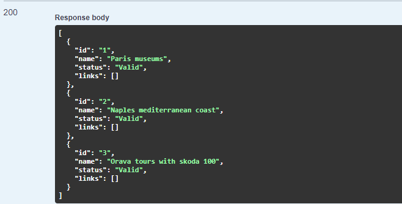
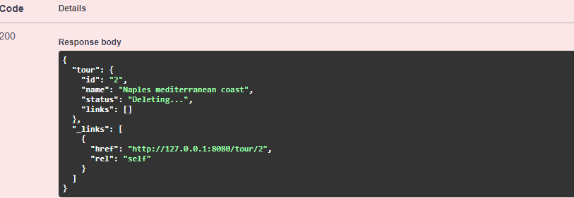
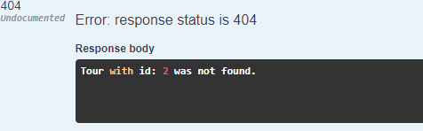

# HW4

### Async delete
Na serveri je simulované asynchrónne vymazanie **Tour** pomocou **DELETE** requestu. Po odoslaní delete požiadavku pre Tour s daným id sa užívatelovi vráti odpoveď s detailom na danú Tour pričom jej paramater ** status ** sa nastaví z pôvodného **Valid** na **Deleting...**. Na serveri sa zatiaľ spustí asynchrónna funckia pre vymazanie danej Tour, ktorá simulovane čaká 10s predtým ako Tour skutočne vymaže. Po uplynutí 10s už **GET** požiadavok na Tour s daným id už vráti chybnú odpoveď čím sa vymazanie potvrdilo.

### Example

List of all tours

Deleting tour with id "2"

After 10s the tour is fully deleted

