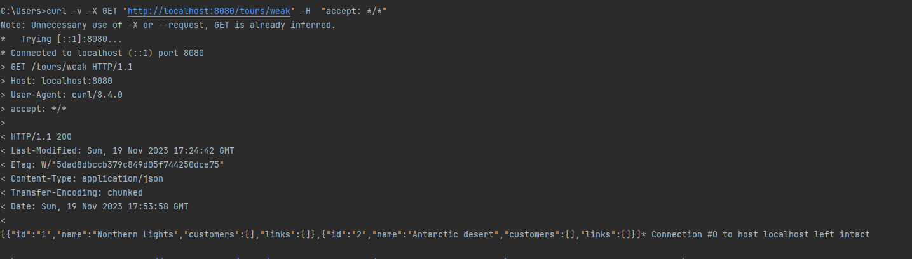
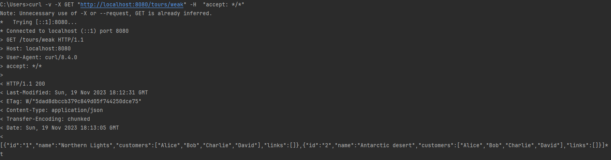
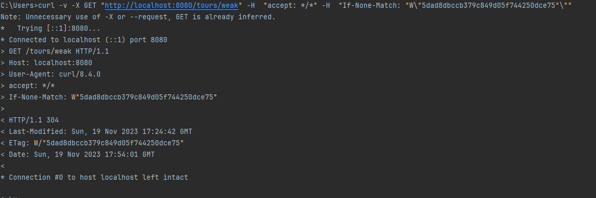
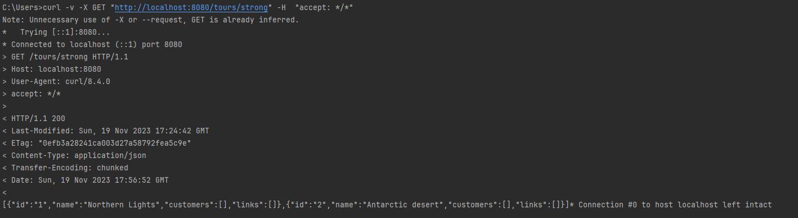
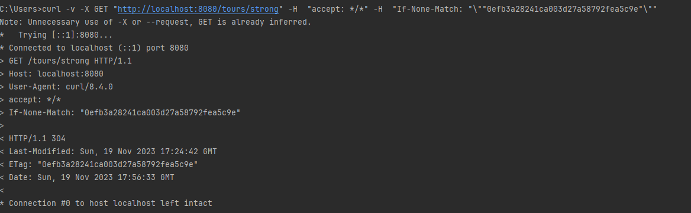
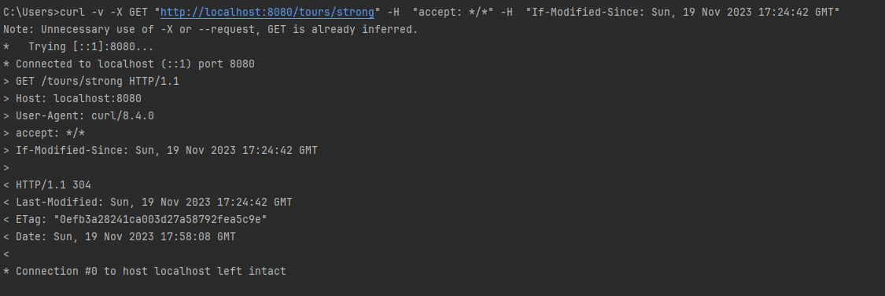

# HW5

Server pri **GET** požiadavku na zobrazenie zoznamu všetkých Tours implementuje jednoduchý cahcing pomocou **ETagov** a hodnoty **Last-Modified**.

### Weak ETag
Weak ETag (`tours/weak`) je generovaný funkciou **generateWeakTourListETag** z **id** a **name** každej Tour a odoslaný v hlavičke http odpovede.

Príklad komunikácie:
`curl -v -X GET "http://localhost:8080/tours/weak" -H  "accept: \*/*"`

Etag sa pri zmene v **customers** nemení.

`curl -v -X GET "http://localhost:8080/tours/weak" -H  "accept: \*/*" -H  "If-None-Match: "W\"5dad8dbccb379c849d05f744250dce75"\""`

### Strong ETag
Strong Etag (`tours/strong`) funguje obdobne ako weak. Rozdiel je vo funckii **generateStrongTourListETag**, ktorá ETag generuje zo všetkých dát v Tours.
`curl -v -X GET "http://localhost:8080/tours/strong" -H  "accept: \*/*"`

`curl -v -X GET "http://localhost:8080/tours/strong" -H  "accept: \*/*" -H  "If-None-Match: "\""0efb3a28241ca003d27a58792fea5c9e"\""`

### Last-Modified
Last-Modified (`tours/weak` alebo `tours/strong`) atribút je implementovaný ako premenná **timestamp** v RestApplicationRepository, ktorá sa mení pri zmene obsahu dát v zozname Tours a jej hodnota je odoslaná v http odpovedi.

`curl -v -X GET "http://localhost:8080/tours/strong" -H  "accept: \*/*" -H  "If-Modified-Since: Sun, 19 Nov 2023 17:24:42 GMT"`

