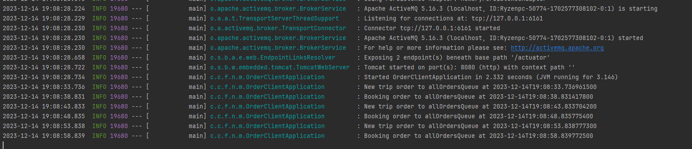
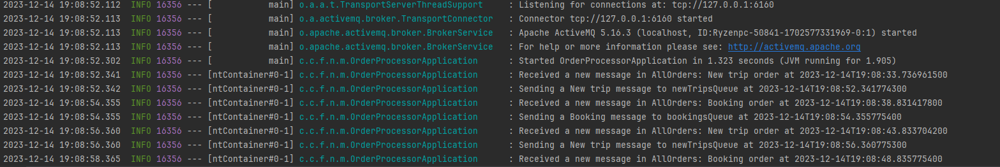
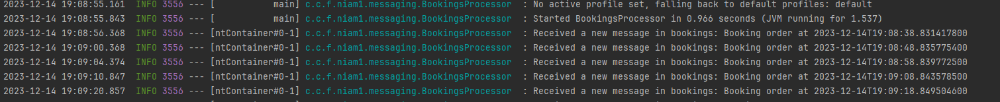
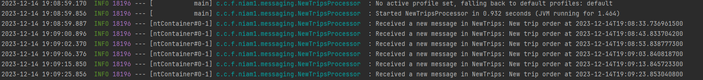

## JMS - Message Forwarding

There are four separate projects, one for each processor agent.
Logs of each processor agent in action are below:

---

*Order Client* - produces all orders and sends them to the first queue

*Order processor* - consumes the orders from the first queue and forwards it either to a booking queue or a new trips queue

*Bookings processor* - consumes the messages from the bookings queue

*New trips processor* - consumes the messages from the new trips queue

