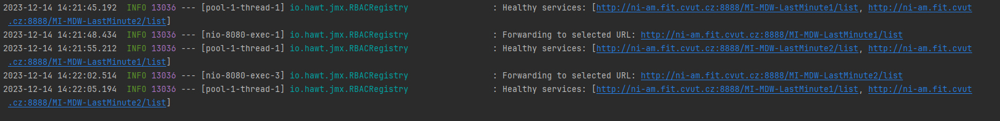
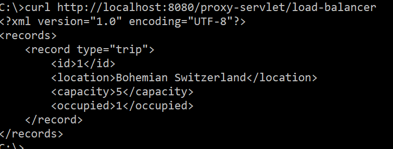

= Simple Load Balancer

== Overview

A simple load balancer that monitors the health of services, selects one in a round-robin fashion, and forwards a GET request.

== Functions

1. The function *monitorServices* checks the health of the services every 10 seconds and maintains a list of the healthy ones in a list.

2. *getNextHealthyService* selects the next service to forward a request to using
a simple round-robin algorithm.

`Console logs after sending 2 requests:`

&#8203;3. The *doGet* function now selects a healthy service, forwards the request there and
returns the response from the remote service back.

Command to call the GET function:
`curl http://localhost:8080/proxy-servlet/load-balancer`

